# Workforce Attrition AI (Snowflake + Cortex)

An end-to-end HR analytics project in Snowflake: raw data, a modeled star schema with a scheduled
pipeline, embeddings, vector search, and a retrieval-augmented generation (RAG) assistant that answers
questions about why employees leave, grounded in real attrition statistics and exit-interview comments.

**Data:** the public IBM HR Employee Attrition dataset (Kaggle) plus 300 **synthetic** exit-interview
comments generated for this project. No real employee data is used.

## Architecture
1. **Raw layer** (`RAW`): CSVs loaded from an internal stage with `COPY INTO`.
2. **Modeled layer** (`ANALYTICS`): department and employee dimensions plus an attrition fact table with
   engineered features (overtime flag, tenure band, satisfaction score, stalled promotion flag).
   A stored procedure rebuilds the model and a Snowflake Task runs it daily.
3. **Embeddings:** `AI_EMBED` (Arctic embed model) stores a 768-dimension vector for each comment.
4. **Vector search + RAG:** a question is embedded, the 5 most similar comments are retrieved with
   `VECTOR_COSINE_SIMILARITY`, and `AI_COMPLETE` (Claude Sonnet 4.5, cross-region inference) answers using only those comments and the
   department attrition stats, citing comment IDs.
   **Department-aware retrieval:** when a question names a department (including aliases like "R&D" and "HR"),
   retrieval is filtered to that department's comments first, then ranked by similarity.
5. **Governance:** a masking policy hides employee IDs from non-admin roles.
6. **Dashboard:** attrition by department, overtime, job role, and tenure, plus comment themes.

## Key findings (IBM HR dataset, 1,470 employees)
- **Overtime:** employees who work overtime left at **30.5%**, versus **10.4%** for those who don't, nearly **3x** the rate.
- **Tenure:** first-year employees (0 to 1 years) left at **34.9%**, versus **10.4%** for those with 10+ years.
- **Job role:** Sales Representatives had the highest attrition at **39.8%**; Research Directors the lowest at **2.5%**.
- **Department:** Sales **20.6%**, Human Resources **19.0%**, Research & Development **13.8%**.
- Exit-comment themes are synthetic and used only to demonstrate retrieval, not as findings.

## Run order
`sql/01_setup_and_load.sql` > `02_model_and_pipeline.sql` > `03_embeddings.sql` >
`04_vector_search_and_rag.sql` > `05_governance_and_dashboard.sql` > `06_department_aware_rag.sql`

## RAG assistant in action
**Question:** *What do employees say about promotions?* The answer cites 5 comment IDs and notes the pattern is concentrated in Research & Development.

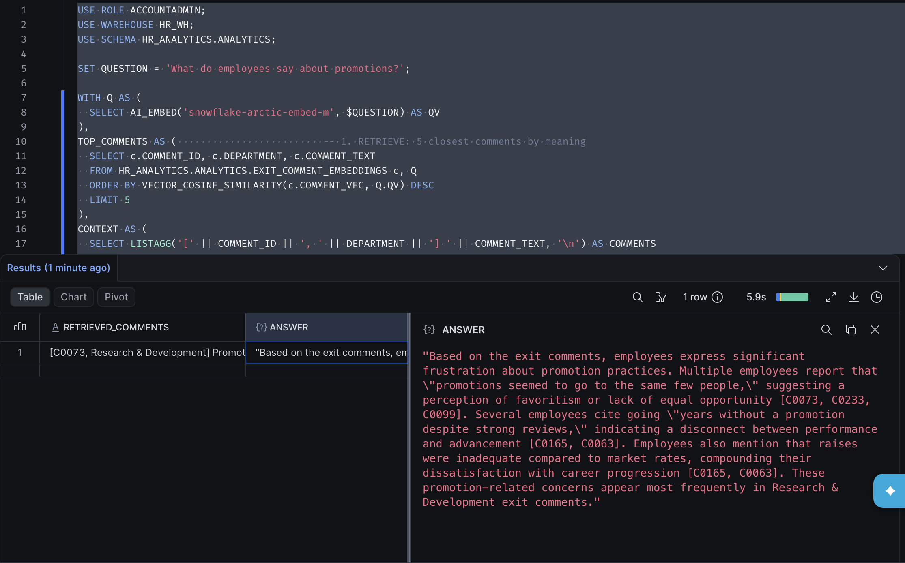

**Question:** *Why are Sales employees leaving?* The answer combines department statistics with cited comments, and flags that only two Sales comments were retrieved instead of overstating its conclusion.

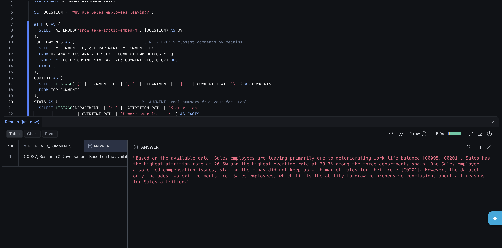

## Improvement: department-aware retrieval
The Sales answer above showed a retrieval gap: ranking every comment by meaning pulled in comments from
other departments, so only 2 of the 5 were from Sales. `06_department_aware_rag.sql` adds a metadata
pre-filter. The query detects a department named in the question, restricts retrieval to that
department, then ranks by cosine similarity. Questions that name no department still search everything.

| Question | Filter applied | Result |
|---|---|---|
| Why are Sales employees leaving? | Sales | 5 of 5 comments from Sales (was 2 of 5) |
| Why are R&D employees leaving? | Research & Development | 5 R&D comments; work-life balance and pay |
| What do HR staff say about their managers? | Human Resources | 5 HR comments; lack of feedback, manager turnover |
| What do employees say about promotions? | none (all departments) | Same cross-department behavior as before |

**After:** the Sales answer now cites five Sales comments and ties them to the department's 20.6% attrition and 28.7% overtime rate.

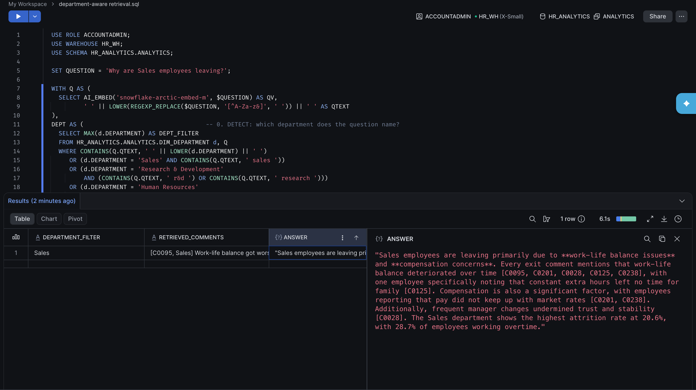

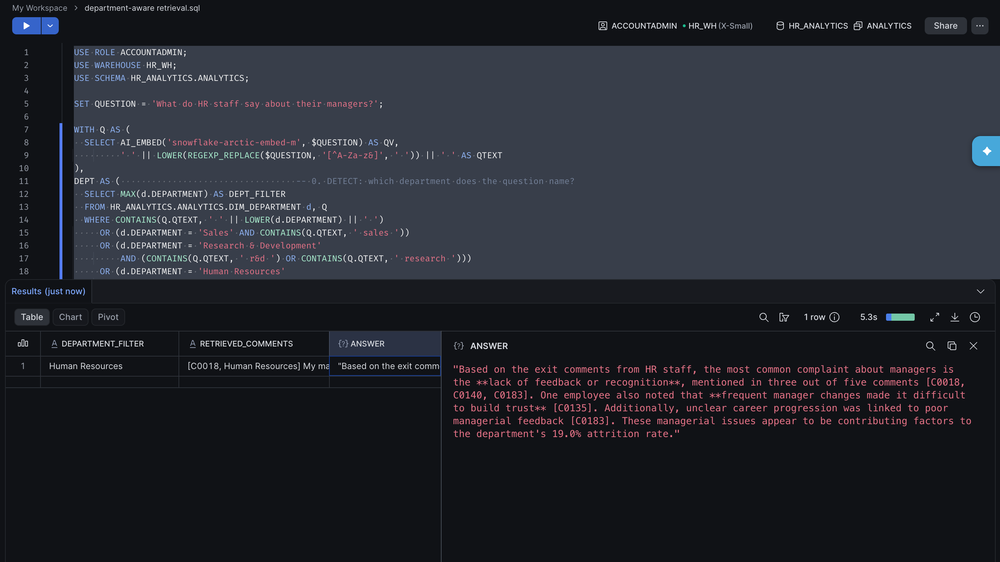

## Semantic search
Searching for "exhausted from long hours" returns comments like "it wore me down" and "constant extra hours left no time for my family," even though none share a keyword with the query.

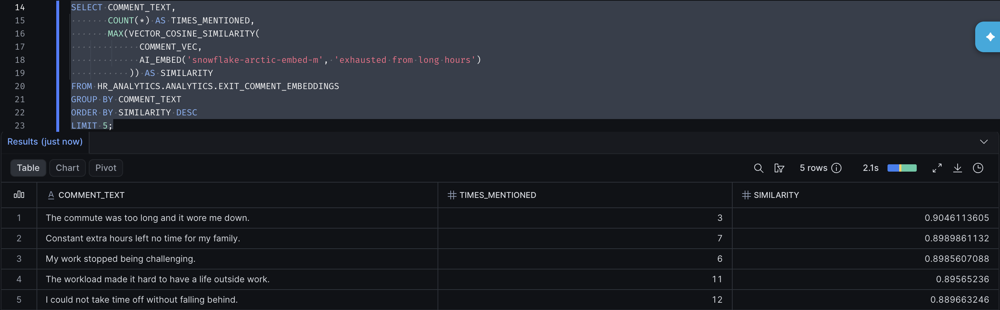

## Dashboard
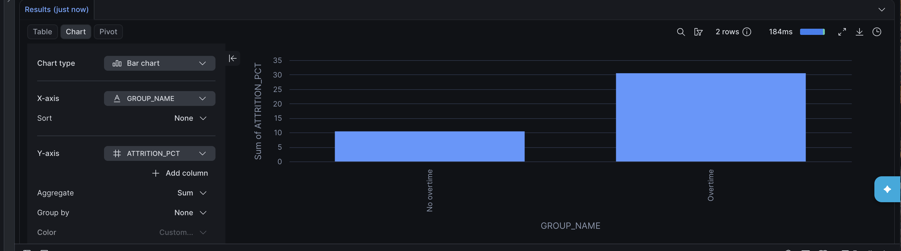
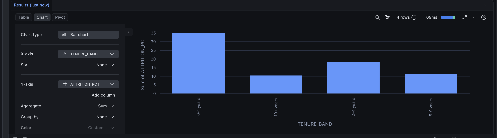
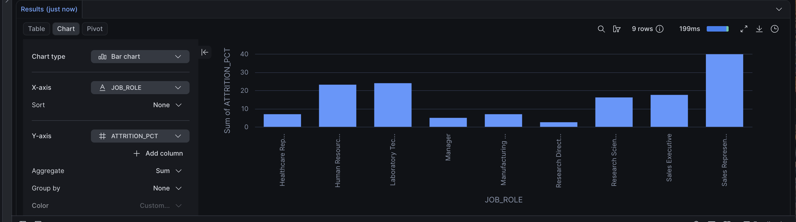
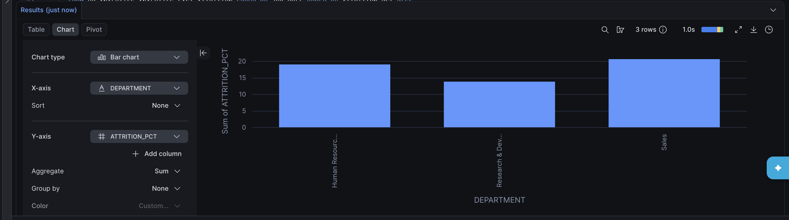

## Data masking (admin vs. analyst role)
The same query returns real employee IDs to ACCOUNTADMIN and NULL to the least-privilege HR_ANALYST role.

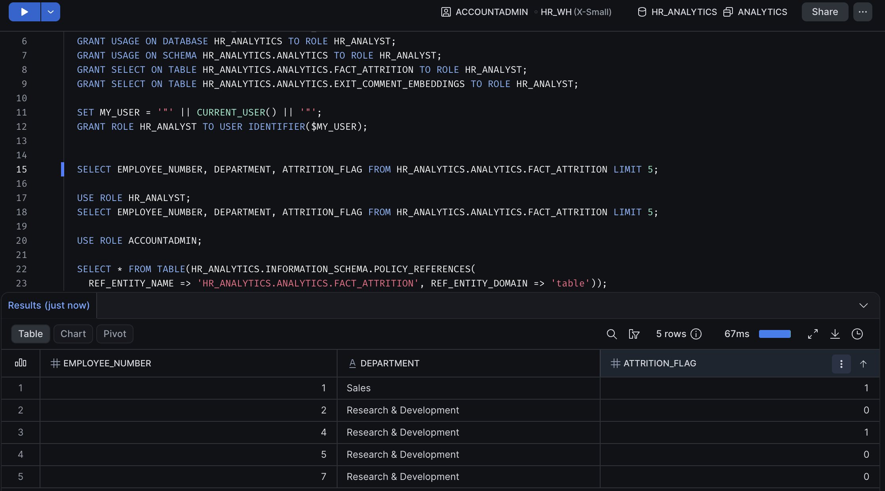
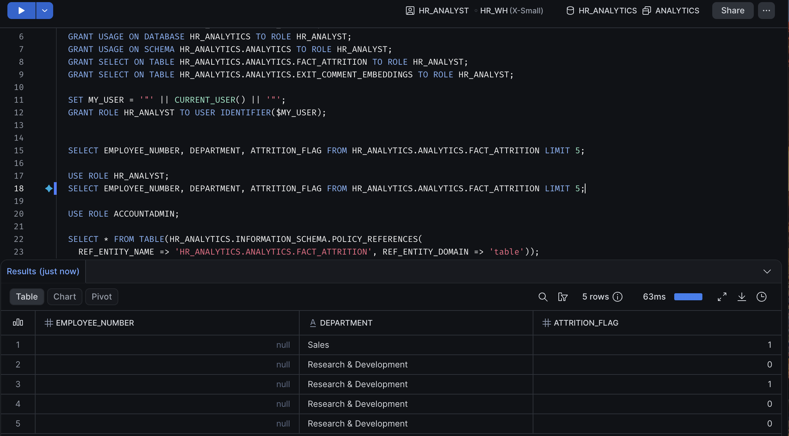
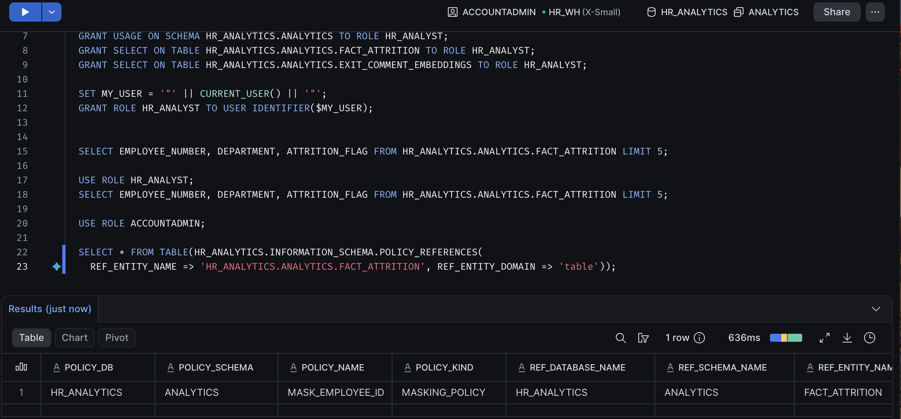

## Limitations and next steps
- Department detection uses keyword and alias matching, so a question that describes a department indirectly (for example, "the people who sell our products") falls back to searching all departments. Next step: let the LLM extract the department as structured output before retrieval.
- Similarity scores for top results cluster closely, so ranking is not always sharp. Next steps: a minimum similarity threshold, a larger embedding model, or hybrid keyword plus vector search.
- Exit comments are synthetic; with real data, retrieval quality and findings would need re-validation.
- Built on a Snowflake trial account: AI functions require a payment method on trial accounts, and current LLMs are served through cross-region inference from AWS US West 2.
